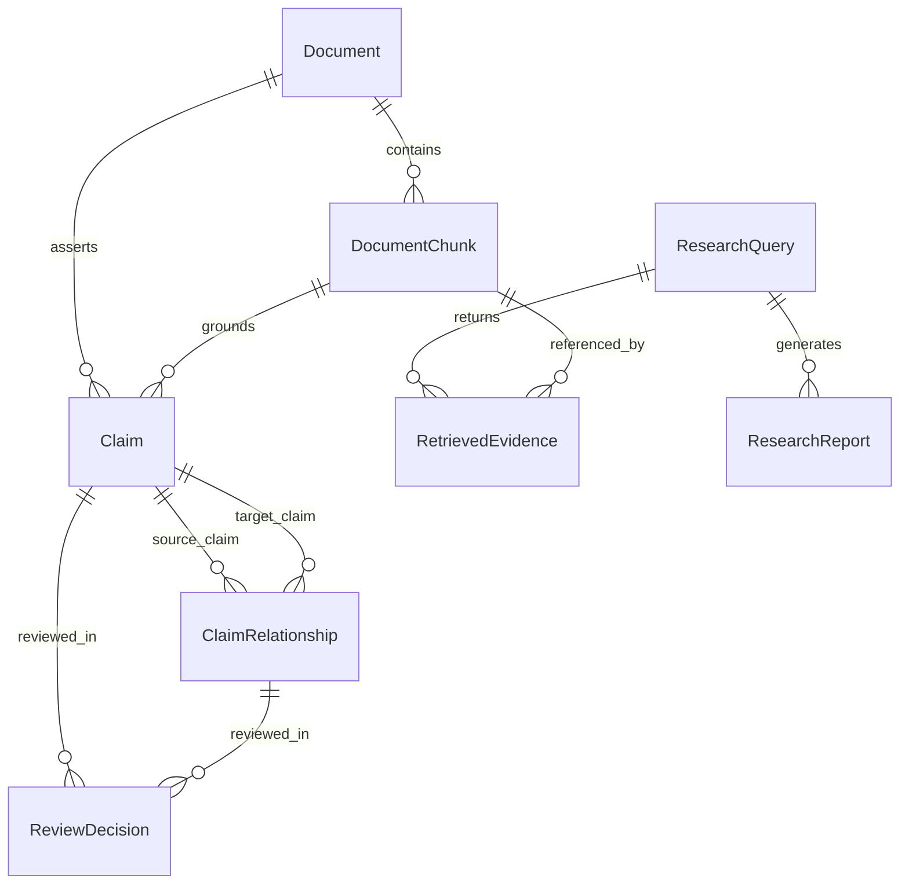

# ResearchGraph AI — Architectural Specification

## 1. Executive Overview

**ResearchGraph AI** is an open-source, evidence-grounded research intelligence platform designed to transform heterogeneous research papers and technical documents into a verifiable, interconnected knowledge-and-claim system. Unlike standard conversational PDF wrappers, ResearchGraph AI treats factual assertions, their exact source offsets, and their inter-document relationships (agreement, contradiction, qualification, dependency) as first-class entities.

```
                              ┌────────────────────────────────────────┐
                              │            Raw Documents               │
                              │       (PDFs, TXT, Markdown)            │
                              └──────────────────┬─────────────────────┘
                                                 │
                                                 ▼
                              ┌────────────────────────────────────────┐
                              │         Ingestion Pipeline             │
                              │  - PyMuPDF Layout Parsing              │
                              │  - Offset-Preserving Chunker           │
                              │  - SHA-256 Deduplication               │
                              │  - Dense Semantic Embeddings           │
                              └──────────────────┬─────────────────────┘
                                                 │
                                                 ▼
       ┌─────────────────────────────────────────┴─────────────────────────────────────────┐
       │                                                                                   │
       ▼                                                                                   ▼
┌──────────────────────────────┐                                            ┌──────────────────────────────┐
│       Vector Store           │                                            │       PostgreSQL Graph       │
│  - pgvector Cosine Index     │                                            │  - Document & Chunk Provenance│
│  - BM25 Lexical Term Index   │                                            │  - Claims & Scientific Entities│
│  - RRF Hybrid Retrieval      │                                            │  - Directed Stance Relations │
└──────────────┬───────────────┘                                            └──────────────┬───────────────┘
               │                                                                           │
               └─────────────────────────────────┬─────────────────────────────────────────┘
                                                 │
                                                 ▼
                              ┌────────────────────────────────────────┐
                              │    7-Agent LangGraph Orchestration     │
                              │                                        │
                              │  1. Research Planner                   │
                              │  2. Evidence Retriever                 │
                              │  3. Claim Extractor                    │
                              │  4. Evidence Comparator                │
                              │  5. Synthesis Agent                    │
                              │  6. Citation Validator (Strict Audit)  │
                              │  7. Report Generator                   │
                              └──────────────────┬─────────────────────┘
                                                 │
                                                 ▼
                              ┌────────────────────────────────────────┐
                              │          Research Dashboard            │
                              │  - Traceable Interactive Citations     │
                              │  - Canvas Knowledge Graph Visualizer   │
                              │  - Contradiction Human-Review Queue    │
                              │  - Cross-Paper Comparison Matrix       │
                              │  - Scientific Evaluation Benchmarks    │
                              └────────────────────────────────────────┘
```

---

## 2. Core Subsystems

### 2.1 Ingestion & Provenance Engine (`backend/ingestion/`)
- **PyMuPDF (`fitz`) Layout Parser**: Extracts structured text per page, preserving exact page indices (1-indexed), section headings (e.g. `1. Introduction`, `3. Empirical Findings`), and document metadata. Never hallucinates metadata: missing titles or authors are left as `None` or empty lists.
- **Deduplication**: Computes SHA-256 checksums on raw file streams before parsing. Duplicate uploads are rejected with HTTP 409 Conflict.
- **Sliding-Window Chunker**: Segments content into ~1,400-character windows with 200-character overlap while tracking `start_char`, `end_char`, and `section_title`.
- **Cascade Deletion**: Removing a document automatically purges all derived chunks, embeddings, claims, graph edges, and review decisions via Django's relational constraints.

### 2.2 Hybrid Retrieval & Reranker (`backend/retrieval/`)
- **Dense Vector Search**: Computes cosine similarity against chunk embeddings ($D=384$) stored in PostgreSQL via `pgvector` or in-memory vector projections.
- **Sparse Lexical Search**: Term frequency with log-TF saturation and section/title match weighting.
- **Reciprocal Rank Fusion (RRF)**:
  $$RRF(d) = \sum_{m \in \{vec, lex\}} \frac{1}{k + rank_m(d)} \quad (k=60)$$
  Combined with underlying vector/lexical similarity scores to ensure irrelevant queries receive low confidence scores rather than artificial 1.0 rank normalizations.
- **Density Reranker**: Performs multi-factor rescoring based on exact phrase alignment, heading match, and query token density.

### 2.3 Structured Claim & Stance Comparison (`backend/claims/`)
- **Claim Extraction**: Extracts structured factual claims $C = \{text, passage, page, section, confidence, entities\}$.
- **Stance & Contradiction Detection**:
  - Compares pairs of claims across documents on shared entities/topics.
  - Analyzes directional stance (positive empirical lemmas vs. degradation/failure lemmas).
  - Explicitly distinguishes genuine contradictions from simple semantic similarity:
    - Shared entity + opposing empirical direction $\rightarrow$ `CONTRADICTS`.
    - Shared entity + constraint keywords (`only when`, `provided that`) $\rightarrow$ `QUALIFIES`.
    - Shared entity + concordant direction $\rightarrow$ `SUPPORTS`.
  - Flags ambiguous cases for the human-in-the-loop review queue.

### 2.4 Knowledge Graph Architecture (`backend/graph/`)
- Stored relationally in PostgreSQL without requiring external graph database overhead for MVP scale:
  - **Nodes**: Documents, Authors, Topics, Entities, Claims, Evidence Passages.
  - **Edges**: `AUTHORED_BY`, `HAS_TOPIC`, `MENTIONS_ENTITY`, `ASSERTS_CLAIM`, `GROUNDED_IN`, `SUPPORTS`, `CONTRADICTS`, `QUALIFIES`, `DEPENDS_ON`.
  - **Interactive Visualizer**: HTML5 Canvas with force-directed physics, zoom/pan navigation, node filtering, and 1-click citation drawer.

### 2.5 Multi-Agent Research Workflow (`backend/agents/`)
Powered by LangGraph using a strictly bounded state graph:
1. **Research Planner**: Decomposes natural language queries into 3 targeted subquestions.
2. **Evidence Retriever**: Queries hybrid index for main query and subquestions; enforces sufficiency threshold ($\ge 0.25$). If insufficient evidence is found, routes directly to Report Generator with grounded refusal.
3. **Claim Extractor**: Identifies factual claims with exact supporting passages and source numbers `[1]`, `[2]`.
4. **Evidence Comparator**: Cross-references claims across papers to detect agreements and empirical contradictions.
5. **Synthesis Agent**: Drafts comprehensive synthesis with bracketed numeric citations.
6. **Citation Validator**: Audits every citation in the text against the actual retrieved candidate set. Rejects fabricated citations. If precision $< 1.0$ and retry limit $< 2$, loops back with audit feedback.
7. **Report Generator**: Produces audit-ready report with executive summary, claim-by-claim breakdowns, and explicit limitation notices.

---

## 3. Database Schema



---

## 4. Security & Safety Model

1. **Untrusted Input Treatment**: Uploaded documents are treated as untrusted data. Text content is passed inside distinct, isolated user prompts rather than executable system instructions.
2. **File Validation**: Enforces MIME and extension restrictions (`.pdf`, `.txt`, `.md`) and a 30MB file size ceiling.
3. **Grounded Refusal**: Prevents hallucinations by refusing to speculate when indexed context is insufficient.
4. **Data Isolation**: Deletions cascade cleanly across foreign keys, preventing orphan embeddings or lingering text in derived tables.
